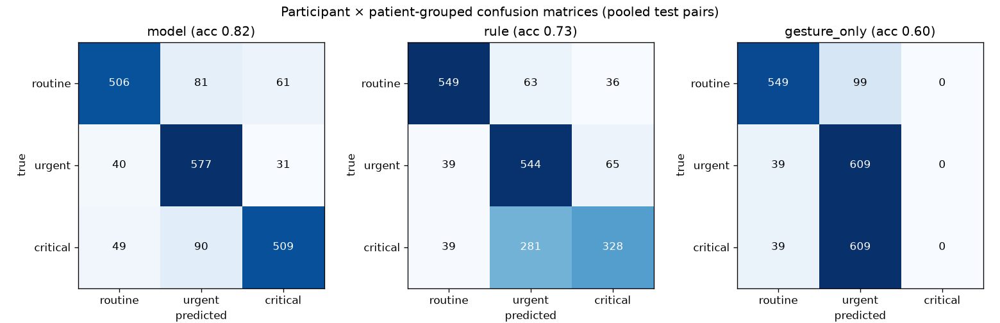
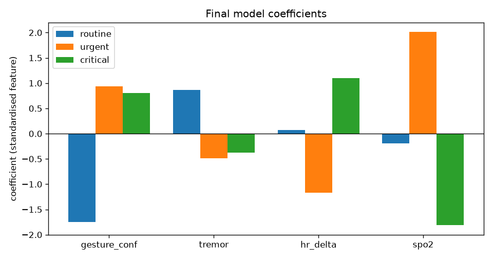

# ML results — composed gesture + ICU-vitals dataset

Generated by `python -m ml.report` on 2026-10-25 23:21 from `ml/results` (commit `ab5ed28`). Do not edit by hand; re-run the generator.

## 1. Data

The dataset is **composed**: gesture windows and vital-sign windows come from different people and were **not recorded at the same time**. They are paired afterwards by a fixed rule.

- **Gestures:** our Pi camera, gesture-only protocol (`ml.collect.session --bio none`), 2 healthy participants (P1, P2). 30-s trials of 3-s windows, labelled `gesture` / `no_gesture` by the scenario before recording. The first window of each trial and redone (discarded) trials are dropped.
- **Vitals:** BIDMC PPG and Respiration Dataset (PhysioNet), 49 ICU patients, 3-s windows of HR and SpO₂ labelled with NEWS2-based rules (`ml/data/public/README.md`): 3392 normal, 1879 abnormal.
- **Pairing rule:** gesture+normal=urgent, gesture+abnormal=critical, no_gesture+normal=routine, no_gesture+abnormal=routine. Classes balanced (n = min(#gesture, #no_gesture) windows per class); seed 42.

**Why no gesture + abnormal vitals = routine.** Our system is a patient-initiated alert channel; vitals-only deterioration is handled by the standard ICU bedside monitor alarms, so a desaturating patient without a gesture stays routine in our system by design. This matches the expected case 3 in our proposal.

| participant | gesture windows | no_gesture windows |
| --- | --- | --- |
| P1 | 108 | 108 |
| P2 | 108 | 108 |

Redone trials: 4 attempt(s) dropped, keeping one attempt per trial (4 flagged as discarded by the operator: P1_G_WEAK_T1_20261025-212051, P1_N_REST_T1_20261025-205241, P1_N_REST_T1_20261025-205335, P2_G_WEAK_T2_20261025-214225; 0 unflagged duplicate(s) dropped as older attempts).

Dropped before pairing: 52 first windows, 36 windows from 4 discarded trial(s). Final model trained on 648 pairs (routine 216, urgent 216, critical 216).

## 2. Method

- **Features:** `gesture_conf`, `tremor`, `hr_delta`, `spo2` (ΔHR = HR − 75 bpm adult resting reference).
- **Model:** StandardScaler + LogisticRegression(C=1.0, class_weight=balanced, max_iter=2000). No hyper-parameter tuning.
- **Evaluation:** leave-one-participant-out × BIDMC patient-grouped split: patients in 3 groups, each with both normal and abnormal patients; each of the 6 folds holds out one participant **and** one patient group, so test pairs never share a person or an ICU patient with training pairs. With 2 participants, leave-one-participant-out has only 2 folds (× 3 patient groups = 6 folds in total), so each model is trained on the gestures of a single participant.
- **Baselines on the same test pairs:** fixed rule (critical if gesture_conf ≥ 0.8 and ΔHR ≥ 15; urgent if gesture_conf ≥ 0.8; else routine) and gesture only (urgent if gesture_conf ≥ 0.8, else routine).

## 3. Results (mean ± SD over folds)

| Method | Accuracy | Macro-F1 | Alert recall | Alert FPR | Critical precision | Critical recall |
| --- | --- | --- | --- | --- | --- | --- |
| Fusion model (LR) | 0.819 ± 0.074 | 0.815 ± 0.076 | 0.931 ± 0.079 | 0.219 ± 0.234 | 0.868 ± 0.110 | 0.785 ± 0.174 |
| Fixed rule | 0.731 ± 0.071 | 0.722 ± 0.074 | 0.940 ± 0.035 | 0.153 ± 0.167 | 0.766 ± 0.104 | 0.506 ± 0.158 |
| Gesture only | 0.596 ± 0.044 | 0.492 ± 0.031 | 0.940 ± 0.035 | 0.153 ± 0.167 | — | 0.000 ± 0.000 |

Alert = urgent or critical. FPR = share of routine pairs that raised an alert.

### Per fold

| Fold | Held-out participant | Patient group | Test pairs | Model acc | Rule acc | Gesture-only acc | Model critical recall |
| --- | --- | --- | --- | --- | --- | --- | --- |
| 0 | P1 | 0 | 324 | 0.910 | 0.772 | 0.636 | 0.880 |
| 1 | P1 | 1 | 324 | 0.827 | 0.732 | 0.636 | 0.593 |
| 2 | P1 | 2 | 324 | 0.886 | 0.827 | 0.636 | 0.907 |
| 3 | P2 | 0 | 324 | 0.772 | 0.688 | 0.556 | 0.759 |
| 4 | P2 | 1 | 324 | 0.710 | 0.620 | 0.556 | 0.574 |
| 5 | P2 | 2 | 324 | 0.809 | 0.747 | 0.556 | 1.000 |

### Confusion matrices (all test pairs pooled; rows = true, columns = predicted)

**Fusion model (LR)** (accuracy 0.819, macro-F1 0.819)

| true \ predicted | routine | urgent | critical |
| --- | --- | --- | --- |
| routine | 506 | 81 | 61 |
| urgent | 40 | 577 | 31 |
| critical | 49 | 90 | 509 |

**Fixed rule** (accuracy 0.731, macro-F1 0.726)

| true \ predicted | routine | urgent | critical |
| --- | --- | --- | --- |
| routine | 549 | 63 | 36 |
| urgent | 39 | 544 | 65 |
| critical | 39 | 281 | 328 |

**Gesture only** (accuracy 0.596, macro-F1 0.494)

| true \ predicted | routine | urgent | critical |
| --- | --- | --- | --- |
| routine | 549 | 99 | 0 |
| urgent | 39 | 609 | 0 |
| critical | 39 | 609 | 0 |

### Random split (comparison only)

Random 5-fold split of all pairs: accuracy 0.884, macro-F1 0.883. A random split looks better because the same participant and the same ICU patient appear in both training and test pairs (and windows from one 30-s trial or one patient recording are near-copies). The participant x patient-grouped split is the honest estimate for a new person and a new patient.

### Final model coefficients (standardised features)

| Class | gesture_conf | tremor | hr_delta | spo2 | intercept |
| --- | --- | --- | --- | --- | --- |
| routine | -1.744 | +0.865 | +0.069 | -0.197 | +0.687 |
| urgent | +0.937 | -0.488 | -1.169 | +2.010 | -0.474 |
| critical | +0.808 | -0.377 | +1.100 | -1.813 | -0.213 |

**Tremor coefficient — what it does and does not show.** The tremor coefficient is highest for routine (+0.865; urgent -0.488, critical -0.377). The tremor feature measures fingertip movement over 3 s; in our recordings the largest movements came from incidental actions (scratching, adjusting) (median tremor per 3-s window: N_SCRATCH 0.189, N_REST_SHAKY 0.072, G_PALM_SHAKY 0.066; G_PALM 0.018), so the model learned to associate high movement with routine. It does not show that clinical tremor indicates safety; establishing tremor's clinical value needs patient data (future work).

**Tremor weight on trembling palms and scratching (held-out test pairs).** On trembling-palm windows the model's alert recall is 0.889 vs 0.972 for the rule (P1 held out: 0.778 vs 0.944); all misses were classified routine. On scratching windows the model raised 4.2% false alerts vs 0% for the rule. The camera's gesture score alone already separates scratching from a raised palm, so the tremor weight does not help reject accidental movements; it is a side-effect of how movement appeared in our recordings and it reduces sensitivity to trembling gestures. Redefining or removing the tremor feature is future work.

Exported to `model.json`; the NumPy runtime on the Pi matches scikit-learn to 2.2e-16 (max absolute probability difference).

## 4. Demo replay inputs and four-case check

| Replay | BIDMC record | Seconds | HR (min–max) | SpO₂ (min–max) | Selection |
| --- | --- | --- | --- | --- | --- |
| rest | bidmc_39 (s 198–258) | 60 | 73–79 | 97–97 | NEWS2-normal every second (SpO2 >= 96 and 51 <= HR <= 90); mean HR closest to 75 |
| exertion | bidmc_52 (s 129–219) | 90 | 115–115 | 92–93 | NEWS2-abnormal every second, with BOTH HR >= 111 and SpO2 <= 93 |

Median gesture_conf/tremor of the gesture and no_gesture windows, with the mean HR/SpO₂ of each replay file:

| Case | gesture_conf | ΔHR | SpO₂ | p(routine/urgent/critical) | Model | Rule | Expected | Model = expected, every replay window |
| --- | --- | --- | --- | --- | --- | --- | --- | --- |
| no palm + rest replay | 0.10 | +0 | 97.0 | 0.98 / 0.02 / 0.00 | routine | routine | routine | 60/60 |
| no palm + exertion replay | 0.10 | +40 | 92.5 | 0.88 / 0.00 / 0.12 | routine | routine | routine | 90/90 |
| palm + rest replay | 0.96 | +0 | 97.0 | 0.05 / 0.90 / 0.05 | urgent | urgent | urgent | 60/60 |
| palm + exertion replay | 0.96 | +40 | 92.5 | 0.01 / 0.00 / 0.99 | critical | critical | critical | 90/90 |

## 5. Discussion (generated from the numbers above)

- **Model vs rule.** Mean accuracy 0.819 vs 0.731 (+8.8 percentage points); the model was more accurate in 6 of 6 folds.
- **Critical cases.** The model found 78.5% of critical pairs on average, the rule 50.6%. The rule only uses heart rate (ΔHR ≥ 15); the model can also use SpO₂. In the vitals data, 1294 of 1879 abnormal windows (68.9%) are abnormal only because of low SpO₂, which the rule cannot see.
- **Gesture only** cannot output critical, so its accuracy is capped near two thirds on balanced classes (mean 0.596). Its alert recall (94.0%) equals the rule's, because both raise an alert on the same gesture threshold.
- **False alerts.** The model raised an alert for 21.9% of routine pairs (rule: 15.3%).
- **Where the false alerts come from.** No-gesture scenarios where most windows still scored gesture_conf ≥ 0.8: P2/N_REST (66.7% of 36 windows, median 0.84); P2/N_REST_SHAKY (100.0% of 9 windows, median 0.93). Labels come from the scenario and were not changed; the gesture detector (uncalibrated defaults) could not tell this resting hand from a raised palm.
- **Spread between folds.** Model accuracy ranged from 0.710 (P2 × patient group 1) to 0.910 (P1 × group 0); SD 0.074.
- **Random split.** A random 5-fold split gives 0.884 (+6.5 points vs the grouped split): the same participant and patient appear on both sides, so it overstates performance for a new person and a new patient. The grouped split is the number to report.
- **What separates critical from urgent.** Largest coefficient difference (critical − urgent): `spo2` (-3.82 per standard deviation). ΔHR +2.27, SpO₂ -3.82, gesture_conf -0.13, tremor +0.11.
- **What separates urgent from routine.** gesture_conf +2.68, tremor -1.35, ΔHR -1.24, SpO₂ +2.21.
- **Four-case check (demo inputs).** The model gave the expected level in 4 of 4 cases (table above).

## 6. Limitations

- **Composed data.** Gestures and vitals were never recorded together; the pairing rule creates the labels. The results show how well the model combines the two signals, not how real patients behave.
- **2 healthy participants** acting out gestures; real patients may move differently (weakness, sedation, lines and dressings).
- **NEWS2 as ground truth** for the vitals: a clinical early-warning score, not a diagnosis. Borderline 1-point bands were excluded, which makes the vitals classes easier to separate than in practice.
- **Low heart rate excluded** (HR ≤ 50): logistic regression with a linear ΔHR cannot treat both very low and very high HR as abnormal.
- **ΔHR uses a fixed 75 bpm reference**, not each patient's own baseline.
- **No hyper-parameter tuning, one model family**; the patient grouping and pairing use one fixed seed.
- **Tremor feature lowers sensitivity to trembling gestures:** trembling-palm alert recall 0.889 (model) vs 0.972 (rule), P1 held out 0.778 vs 0.944; scratching false alerts 4.2% vs 0%. The tremor weight reflects how movement appeared in our recordings, not clinical tremor; redefining or removing the feature is future work.

## Appendix: gesture data validation

See `data_report.md` in the results folder (`ml/results/data_report.md`).
